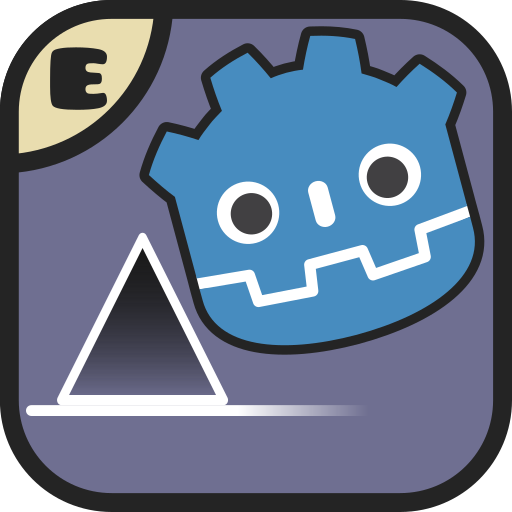

<p align="center">
 </img>
 <h1 align="center">Godot Dash</h1>
</p>

A Geometry Dash fangame made with Godot Engine.

[Discord community](https://discord.gg/8Vn9qDDXZD)

[Credits](./CREDITS.md)

## OS Support

Godot Dash is intended to work on Linux, Windows, and Android.

## Downloads

Head to the [releases](https://codeberg.org/godot-dash/godot-dash/releases/) section and download the latest one.

## Compilation

**⚠️ Make sure to use Godot 4.7. ⚠️**

### Dependencies

- [`git-lfs`](https://github.com/git-lfs/git-lfs#installing)

Game/editor orchestration is GDScript. The current large-level runtime also needs the
C++ GDExtension in `native/` (Python 3, SCons and a platform C++ compiler). CI builds
and bundles it; native-free fallback coverage is incomplete (see `docs/agent-briefing/06-native-extension.md`).

#### Godot Android export

See https://docs.godotengine.org/en/stable/tutorials/export/exporting_for_android.html.

- [`OpenJDK`](https://openjdk.org/install)
- [`Android SDK`](https://developer.android.com/studio)

### Instructions

- Run `git lfs install` if you haven't done so already.
- Clone the repo locally.
- Import the project.godot file.
- Go to `Project → Export` and select the export preset you want.
- Choose an export path.
- Hit `Export Project`.


## Geometry Dash objects

Imported `.gmd` levels draw Geometry Dash's own artwork. The pipeline lives in `tools/`:

| Step | Command | Output |
| --- | --- | --- |
| 1. Object table | `python3 tools/build_object_frames.py --id-list tools/gd_object_id_list.txt` | `assets/textures/gd_atlas/object_frames.json` (object id → sprites, default z layer/order) |
| 2. Godot atlas | `python3 tools/build_godot_atlas.py` | `assets/textures/gd_atlas/gd_objects_atlas_*.png` + `.json` — the cocos2d `-hd` sheets from `assets/textures/gd_atlas/source/` repacked into 4096² pages, rotated frames turned upright, every frame's edge texels duplicated 1px into the packing gutter (`"extruded": 1` in the JSON). That gutter lets the native decoration renderer draw each batch as single triangle arrays with pixel-identical output; without it (or with `--no-extrude`) the renderer stays on per-sprite clipped rects |
| 3. Object scenes | `python3 tools/build_gd_object_scenes.py` | `scenes/gd_objects/gd_<id>.tscn`, one scene per object type |

Each `gd_<id>.tscn` has the object's sprites laid out under `Base` / `Detail`, an empty `Collision`
(`StaticBody2D`, layer 2 = solids) with a `Hitbox` placeholder, and an editor selection box. Open one
in Godot and add the collision shapes you want; every placement of that object type in every level
gets them. Re-running step 3 refreshes the artwork but keeps your `Collision` subtree and the scene UID.

At runtime `Level` instances the type's scene once per placement (`GDObject`). Object types with no
scene fall back to the batched renderer (`DecorationBatch`). While a level plays, `CullingManager`
hides objects beyond a buffer around the camera (Settings → Graphics → Performance → *Culling buffer*,
in cells) so a sudden speed change never shows a gap.

## Runtime performance

The optional GDExtension (`native/`) carries the hot paths that per-object GDScript cannot: the packed
trigger scheduler, the retained-RID decoration renderer with worker-thread culling, the node visibility
index, incremental level construction, shared-physics shape commits — and, since 1.10, colour-channel
propagation (`NativeColorChannelIndex`): one native call repaints every `HSVWatcher` of a channel, which
colour-pulse-heavy levels previously paid as a per-object GDScript call with ~15 property accesses each
animation frame. Native-free fallback coverage is incomplete; use the packaged native DLL
when testing Windows large levels.

Per-frame GDScript is kept lean as well: the 240 Hz player loop resolves its scene nodes through cached
references instead of `$Path` lookups, and idle interactable components (easings, rebounds, music-pulse
scales, toggle sprites) only process while a tween is live or the player is within interaction range.
Rebound orbs/pads and the gameplay-trigger clocks run from one shared `SceneTree.physics_frame` driver
instead of one engine callback per placed object, and the per-tick sprite rotation moved behind the
optional `NativeSpriteTick` extension class (the GDScript function remains the fallback). Online level
downloads now parse on a worker thread, report real byte progress, reuse pooled `HTTPRequest` nodes,
skip levels already saved locally, and compute the level bounds in the packed import's single pass
instead of re-scanning the whole level string. See `reports/performance-online-2026-10-21.md` for the
full change list, the parity tests and the verification limits.

Steps 1–2 need Python 3 and Pillow (`pip install pillow`).

## Windows Forward+ builds

`.github/workflows/windows.yml` builds an x86-64 release executable with Godot 4.7.2
and an optimized, statically linked C++ runtime DLL. `rendering_method.windows` selects
Forward+; the mobile and wasm64/WebGPU web settings are unchanged. Forward+ is the
requested Windows renderer, not an assertion that it is faster for this 2D game.

Download the ZIP from **Build Windows Forward+** Actions artifacts or the matching
`windows-<commit>` GitHub prerelease. Extract the **whole** ZIP, then run `Godot Dash.exe`.
It is unsigned and requires a compatible graphics driver. CI checks the actual exported
EXE loads its native DLL headlessly; it cannot verify GPU performance or visual parity.

The package includes `Profile-Windows.ps1` and `README-Windows.txt`. The opt-in capture
records 1800 gameplay/editor frames after 120 warm-up frames, GPU/CPU timings and node
counts; the PowerShell sidecar samples process memory once per second. No effects or
content are hidden. Normal launches have no sampling callback. Profiling has overhead,
and writing the CSV can pause the game once at the end; `sampler_mean_us` and
`finalize_ms` are logged. Compare instrumented runs on the same level/machine/settings.

For normal installation/updates, use **`GodotDashSetup-x86_64.exe`** from the same
Windows release. It installs one **Godot Dash** app and upgrades it in place.
The renamed executable is `Godot Dash.exe`. `user://` is explicitly pinned to the
existing `%APPDATA%\godot-dash` directory, so the display-name change does not
orphan settings, levels, songs, replays or other user files. Setup/uninstall never
remove that directory. Old manually extracted portable folders are not deleted.
The title-screen update check uses this fork's branch-specific GitHub installer
channel, not upstream Codeberg releases; installing remains user-confirmed.
CI exercises first install, upgrade into the registered path, installed native
smoke, and uninstall, comparing user-data hashes across installer operations.

Windows also has a bounded HTTPS-relay fallback after blocked direct public
downloads, matching Web's working route. Supported hostnames are allowlisted;
account requests/credentials are excluded. Network failure can add one bounded
request per attempt (15 seconds for text/levels, 30 for audio). Actual failing
level IDs still need device verification.

**FPS limit** defaults to **0 (no software limit)**, separately from VSync. A one-time migration
clears the old 60/monitor-refresh default caps (an intentional cap equal to that old default
is indistinguishable and must be set again). Other explicit caps survive. Enabled VSync
uses the active Windows/driver display mode, not the fixed 240 Hz physics tick rate. If it
still presents at 60 Hz on a high-refresh display, try **Exclusive Fullscreen** and check
Windows Advanced Display / per-application GPU driver limits. A GPU or compositor refresh
issue cannot be verified by headless CI.

The hidden debug HUD no longer enables GPU timestamp queries or receives per-frame
callbacks. Detailed F3 graphs and captures share timing ownership; hiding one cannot disable
the other. Editor selections retain their ordered array and add a membership index, avoiding
quadratic bulk selection/clone/set operations without changing picking order or content.

Windows CI tests frame-cap migration, GPU-timing ownership and selection parity, including
callback mutations, and benchmarks constructing a 20,000-object selection. The ZIP includes
`runtime-safety.log`. This is an editor-operation microbenchmark, not a whole-game FPS claim.
The earlier, slower decoration channel-index candidate remains only in the standalone
benchmark tools as rejected evidence. No user PowerShell capture is required for these fixes.

## Web (HTML5) builds

The hosted build runs on WebGPU, not WebGL. Official Godot 4.7 web templates
only have the Compatibility renderer, so the export uses [hogdot](https://github.com/hogdanish/hogdot)
`cg-v4.7.2-r19`: a Godot 4.7.2 port of [dwalter's GodotWebGPU](https://github.com/dwalter/godotwebgpu)
driver, Mobile renderer, threads on. The published hogdot web zips strip
`Line2D`, physics shapes, MP3, and zip for another game, so CI builds an
unstripped template from that same commit. It needs a WebGPU browser (Chrome 113+,
Edge, Firefox with WebGPU, Safari 18+) served over HTTPS, plus the same
Cross-Origin Isolation headers the threaded build already required. It still
draws at the browser's resolution.

Browsers only hand a page a cross-origin response when the server opts in with
`Access-Control-Allow-Origin`. None of the level hosts do: `www.boomlings.com`
also answers `403` to the `Origin` header a browser attaches to every
cross-origin POST, `history.geometrydash.eu` sends no CORS header, and the song
CDNs (`geometrydashcontent.b-cdn.net`, `geometrydashfiles.b-cdn.net`) send none
either. Online level *search* therefore keeps working (GDBrowser answers with
CORS headers), but downloading a level or its music requires a relay that
performs the request server-side and answers the browser with CORS headers.

- **Local export:** `python3 tools/serve_web.py --dir export/Web` serves the
  build with the Cross-Origin Isolation headers the threaded build needs *and* a
  `/cors-proxy?url=` relay. A page served from `localhost`/`127.0.0.1` finds it
  automatically.
- **Hosted build (itch.io, static hosting, …):** the export ships with the
  deployed relay in `project.godot`:

  ```ini
  [network]
  cors_proxy="https://gddash.anrandaniel2.workers.dev/?url="
  ```

  Opening that workers.dev address by itself answers `Missing target URL`. That
  is the relay waiting for a target, not a broken deploy. The game appends the
  percent-encoded level URL. A direct check is
  `https://gddash.anrandaniel2.workers.dev/?url=https://history.geometrydash.eu/api/v1/level/128/`.

  To point a build at a different relay, change that setting (or the per-user
  `Internet/cors_proxy` value, read as `Config.cors_proxy`) and re-export.
  `tools/web_relay_worker.js` is the Worker source.

Without a relay the Web build skips those requests and explains the limitation
in-game instead of failing with console CORS errors and
`TypeError: Failed to fetch`.

## Contributing

**⚠️ Make sure to use Godot 4.7. ⚠️**

### Dependencies

See *Compilation*.

### Instructions

- **Read [CONTRIBUTING.md](./CONTRIBUTING.md).**
- Run `git lfs install` if you haven't done so already.
- Clone the repo and import it in Godot.
- Open a PR with your changes.

### Multiple monitors and the next renderer performance pass

The temporary monitor/Hz status text remains removed from Settings. Saved VSync
and FPS preferences are applied at startup; Godot's display backend handles monitor
changes. The experimental polling/reapply hook has been disconnected following a
report of wavy distortion. No renderer, Windows display mode, or monitor-derived
FPS cap is chosen automatically; physical-display verification is still needed.
Windows **Duplicate** mode can share presentation timing; the app cannot guarantee
independent maximum refresh rates for cloned displays. Use **Extend** and set each
display's highest supported refresh rate in Windows for independent high-Hz use.

The native decoration renderer now caches the ordered visible-record IDs between
cell-range changes and skips draw-command invalidation for exactly unchanged
color/blend/transform values. All live effects and draw order remain intact.
See `reports/renderer-cache-2026-10-14.md` for the CPU benchmark, memory trade-off
and limitations; these results are not a whole-level FPS claim.

Static/spinning batches also stop running empty GDScript callbacks after entering
the scene tree (Godot had re-enabled them after off-tree construction). Native
rendering/spin and monster animation clocks are retained. Windows CI covers this
lifecycle and reports a 2,000-node callback microbenchmark.


### Gameplay/presentation corrections

The bottom-left menu label always shows the installed version (plus CI build/commit
on Windows). Update availability remains clickable. Death freeze/marker debugging
has been removed; the normal death effect and one-second restart track are restored.
Hide/Show Player now shares both-slot state with Options and newly created duals.
New and previously saved imported end portals use horizontal-only camera easing.
UI decoration batches align individual object pivots, including Relative+Center,
without stretching sprite parts, and refresh their layout when the viewport resizes.
See `reports/presentation-parity-2026-10-14.md` for tests and remaining device/full-level
verification limits.


The next CPU pass coalesces culling/animation/color draw-command updates into one flush,
resolves common channel HSV once per update, and precomputes immutable native object-HSV
flags. It does not lower detail or change physics/timing. The script probe now respects
`.gdignore` boundaries around standalone benchmark projects. See
`reports/render-recolor-2026-10-14.md` for test coverage, rejected experiments and limits.
